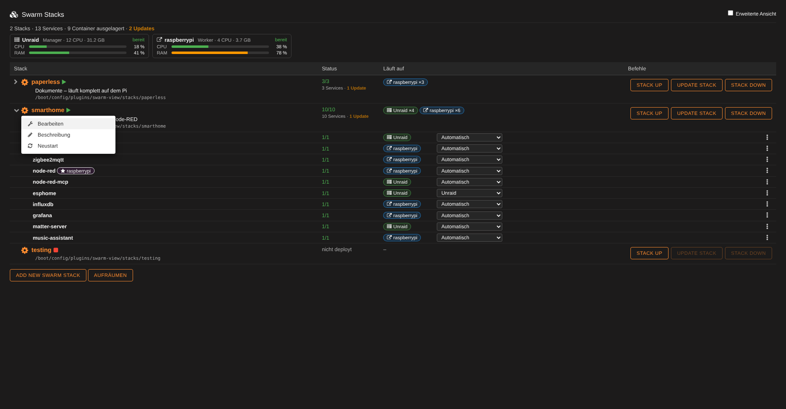
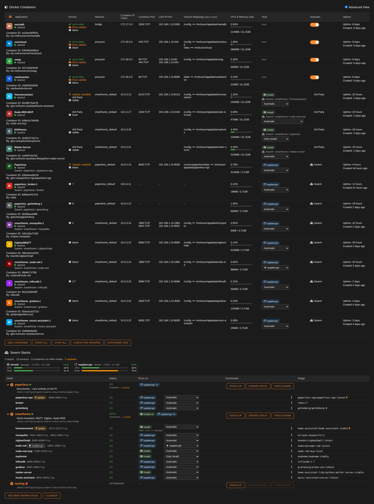
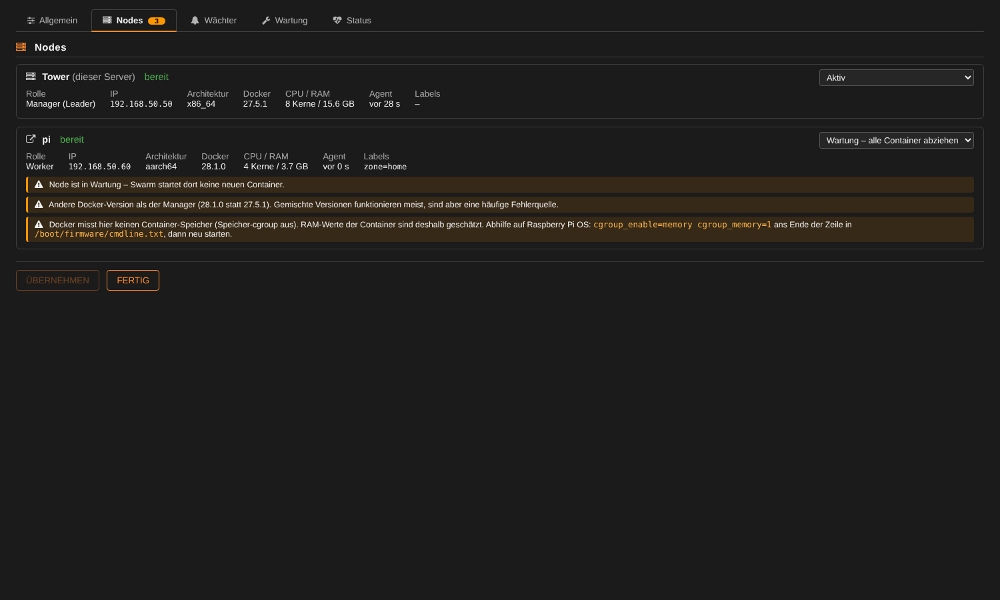

# Swarm View for Unraid

[](https://github.com/Hugo2625/unraid-swarm-view/actions/workflows/ci.yml) [](https://github.com/Hugo2625/unraid-swarm-view/actions/workflows/ui-tests.yml) [](https://hugo2625.github.io/unraid-swarm-view/)

Docker Swarm on the Unraid Docker page. Swarm View is built for a setup where **Unraid is the swarm manager** and small machines (for example a Raspberry Pi) join as workers.



The interface is available in **English** and **German**. It follows Unraid's display language by default; you can also pick a language in the plugin settings.

## Features

- **Swarm Stacks section** on the Docker page, similar to Compose Manager: create stacks, edit `docker-stack.yml` and `.env`, *Stack Up*, *Update Stack*, *Stack Down*, restart. Per service: update, rollback, restart, logs, move to another node.
- **Where does it run?** A host column in Unraid's container list, and rows for containers that run on other nodes – with CPU/RAM, network, IP, ports, uptime, logs and a context menu, like local containers.
- **Node placement at runtime:** *automatic*, *preferred node* (runs there when the node is available, fails over to another node and returns automatically) or *fixed node*. Runtime placement lasts until the next *Stack Up*; for a permanent preference set the label `swarm-view.prefer: <node>` in the stack file.
- **Display names:** Swarm ignores `container_name`. Set the label `swarm-view.name: <name>` and Unraid's list shows that name.
- **Folder View:** containers on other nodes are sorted into folders; folder CPU/RAM totals can include all nodes; folder regexes match real and display names.
- **Notifications** through Unraid: node offline, crash loops, tasks that cannot start, node changes, image updates – each configurable.
- **Update hints** with one-click update and rollback.
- **Cleanup** of stopped task containers and unused images on all nodes, on demand or scheduled.
- **Settings** with tabs: general, nodes (with warnings such as missing memory cgroup or Docker version mismatch), watchdog, maintenance, status.





## Requirements

- Unraid 7.0 or newer
- Docker Swarm initialised with Unraid as manager (`docker swarm init`), workers joined
- Bind-mounted paths (for example `/mnt/user/appdata`) must exist on every node a service may run on – e.g. via NFS

## Installation

Until the plugin is listed in Community Applications: *Plugins → Install Plugin* and paste

```
https://raw.githubusercontent.com/Hugo2625/unraid-swarm-view/main/swarm-view.plg
```

## How it works

- Stack files live on the flash drive in `/boot/config/plugins/swarm-view/stacks/<name>/` and are deployed with `docker stack deploy`.
- CPU/RAM of other nodes come from a small global agent service (`swarm-view-agent`, image `docker:cli`), enabled in the settings. On nodes without memory cgroup (Raspberry Pi OS default) memory is estimated from the processes' RSS.
- A watchdog (cron, every minute) handles notifications, update checks and the return to a preferred node. It only runs when one of these features is enabled.
- Uninstalling removes the plugin and its helper services; stack files and settings stay on the flash drive.

## Building

```
python3 tools/build_plg.py 2026.11.21
```

builds `swarm-view.plg` from `src/swarm-view/`, with the matching section of `CHANGES.md` as changelog.

## Translations

All texts in the code are English. Translations live in `src/swarm-view/lang/<code>.json` as `{ "English text": "translation" }` with placeholders `{0}`, `{1}`, …
`python3 tools/i18n_check.py` lists texts that are missing in a translation file. New languages are welcome as a pull request (add the code to the language select in `SwarmViewSettings.page` and to the `LANGUAGE` check in `include/actions.php`).

## Support

Questions and help: [support thread in the Unraid forum](https://forums.unraid.net/topic/201367-plugin-support-swarm-view-docker-swarm-stacks-on-the-docker-page/).  
Bugs and ideas: [GitHub issues](https://github.com/Hugo2625/unraid-swarm-view/issues).

## Development

Every push and pull request runs automatic checks ([GitHub Actions](../../actions)):

- **CI** – PHP/JS syntax, translations complete, `swarm-view.plg` built from the current `src/`, version raised when `src/` changed, backend tests of `api.php`/`actions.php` against a fake Docker CLI (`python3 tools/ci_checks.py`, `python3 tests/bench/backend/test_backend.py`)
- **UI tests** – the original Unraid Docker page with Folder View 3/2, Compose Manager and Swarm View in headless Chrome, 44 scenarios (plugins on/off, section position, views, themes, languages, narrow screens, API errors, slow API, nodes down, settings). Pull requests: quick set; nightly: everything with 1, 2 and 6 worker nodes against the latest stable Unraid release and the current Folder View / Compose Manager. A new Unraid release is detected within 3 hours and tested automatically; the *tested on Unraid* badge above shows the version of the last published run and turns red if it failed. Results with screenshots of the latest nightly/manual run: **[hugo2625.github.io/unraid-swarm-view](https://hugo2625.github.io/unraid-swarm-view/)** (also attached to each run). Details: [tests/bench](tests/bench)
- **New Unraid release** – every 3 hours: new stable Unraid version (release notes in `unraid/docs`)? → full UI tests against the webgui code of that release line, results page updated
- **Release** – a new version in `swarm-view.plg` on `main` creates a GitHub release with the changelog

Making a change: edit `src/`, add a section to `CHANGES.md`, run `python3 tools/build_plg.py <new version>`, then `python3 tools/ci_checks.py`.

## License

MIT – see [LICENSE](LICENSE).
